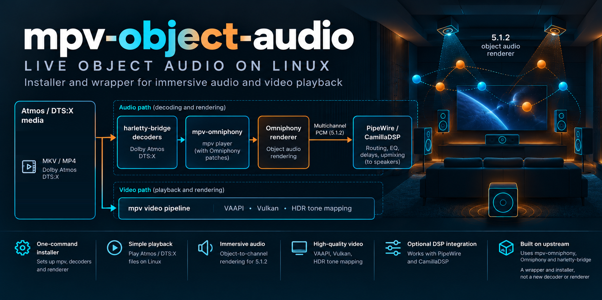

# mpv-object-audio

Full docs: https://praveenchandrahas.github.io/mpv-object-audio/

[](https://github.com/praveenchandrahas/mpv-object-audio/actions/workflows/ci.yml) *(CI = unit tests, lint, and a package install/remove test in a clean Ubuntu 24.04 container. A green badge does not show the software works on a real rig.)*



> **Part of the [Software Defined Home Theatre](https://github.com/praveenchandrahas/Software-Defined-Home-Theatre) project.** The main repository holds the documentation, build log, results and the installer checks; this is one of its parts. Sibling repositories: [linux-theater-dsp](https://github.com/praveenchandrahas/linux-theater-dsp) (router and CamillaDSP configs) · [Roomtone](https://github.com/praveenchandrahas/Roomtone) (measurement, autocal, status page, mpv overlay) · [seekthumbs](https://github.com/praveenchandrahas/seekthumbs) (seek-bar thumbnails) · [mpv-shelf](https://github.com/praveenchandrahas/mpv-shelf) (film browser for mpv).

An installer and wrapper that gives a Linux machine a self-contained **live Dolby Atmos / DTS:X player**: the Omniphony object renderer, the harletty-bridge decoders and a patched mpv,
installed in their own folder and started as the `mpv-object-audio` command, with a video configuration tuned for a 1080p projector (VAAPI, gpu-next on Vulkan, BT.709/BT.1886,
60 nit target peak, bt.2390 tone mapping, mitchell downscaling, deband).

## Credits

The hard part, decoding and rendering Atmos objects live on Linux, is the work of others:
**[Omniphony](https://github.com/mgth/Omniphony)** and **[mpv-omniphony](https://github.com/mgth/mpv-omniphony)** by mgth (the renderer and the mpv integration),
**[harletty-bridge](https://github.com/harletty/harletty-bridge)** by harletty (the decoder plugins), and **[truehdd](https://github.com/truehdd/truehdd)** by Rainbaby (the TrueHD decoder that harletty's decoder is a fork of).
This repository only installs them and wraps mpv; their licences apply to what they provide and are not summarised here.

## Install (pre-release, experimental)

Quick start:

```bash
git clone https://github.com/praveenchandrahas/mpv-object-audio && cd mpv-object-audio
./scripts/object-audio-install.sh deps      # prints one apt line (mpv's build dependencies); run what it prints
./scripts/object-audio-install.sh           # engine and bridges: prebuilt releases; mpv-omniphony has no releases, so mpv is built from source (minutes)
mpv-object-audio film.mkv                   # or right-click a film in Dolphin -> mpv-object-audio
```

A `.deb` pre-release is also available on the [releases page](https://github.com/praveenchandrahas/mpv-object-audio/releases).
Full install steps (both the package and from-source paths), how the installer works, the architecture diagram, and
the third-party licence table are in the **[full docs](https://praveenchandrahas.github.io/mpv-object-audio/install/)**.

What was checked: written with an AI assistant; checked against simulated rooms and REW exports; used and checked by
the author in his own room (one room, one author). No external or second-person validation yet. The packages are
unsigned. CI installs and removes them in clean Ubuntu 24.04; the packaging itself has not been run on the author's
own rig.

## Usage, architecture and licences

See the **[full docs](https://praveenchandrahas.github.io/mpv-object-audio/)** for how to run `mpv-object-audio`
(wrapper flags, environment variables, Dolphin integration), the architecture diagram and how the installer works,
the optional companion repositories (seekthumbs, mpv-shelf), adapting paths/display settings to your own machine, and
the third-party licence table (`Omniphony`, `harletty-bridge`, `mpv-omniphony`, `truehdd`, `mpv`).

## Licence

[Apache License 2.0](LICENSE) (see also [NOTICE](NOTICE)). Dolby, Dolby Atmos, DTS and DTS:X are trademarks of their owners; this project is not affiliated with or endorsed by them. It contains no media files and no decoder code.

Part of the [software-defined home theatre](https://github.com/praveenchandrahas/Software-Defined-Home-Theatre) project.

## On-screen status and controls

The status panel and controls for mpv (press **C**) moved to [Roomtone](https://github.com/praveenchandrahas/Roomtone) (`overlay/`), next to the status page it shares its code path with. Install it from there.
