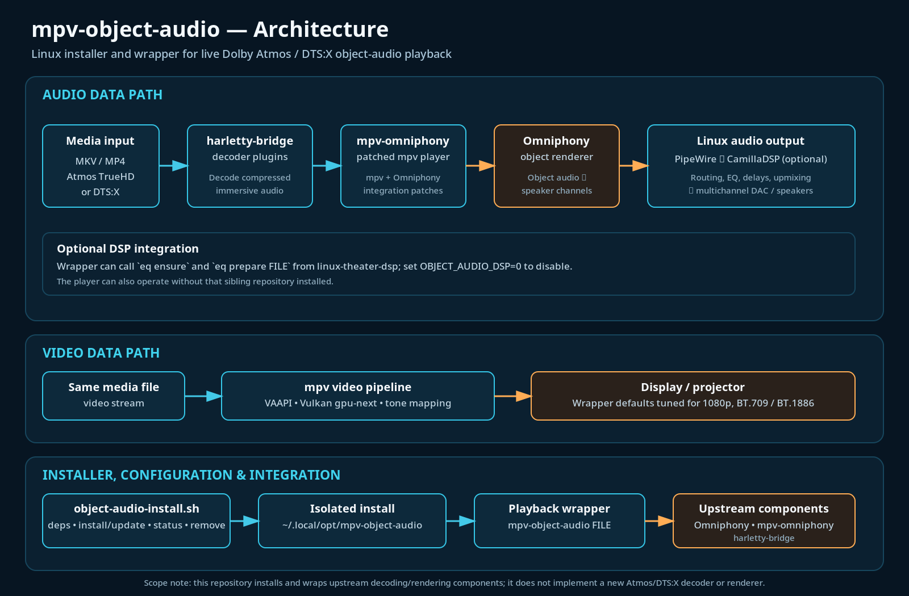

# Install

## From the .deb (pre-release, experimental)

Releases are marked **pre-release** on the [releases page](https://github.com/praveenchandrahas/mpv-object-audio/releases).
Download the `.deb` and `SHA256SUMS` from one release, check, then install:

```sh
sha256sum -c --ignore-missing SHA256SUMS
sudo apt install ./mpv-object-audio_0.1.0_all.deb
mpv-object-audio-install --dry-run   # then: mpv-object-audio-install install
```

This package contains only the `mpv-object-audio` wrapper and the installer. It does **not** include or download
mpv-omniphony, Omniphony or harletty-bridge; the installer runs only when you ask it to, and you should read it first
(`/usr/lib/mpv-object-audio/object-audio-install.sh`). See the main repository's `docs/rebuild-checklist.md`.

The package puts files under `/usr` only. Its install and remove scripts do not enable or start services, do not write
into any home folder, and do not touch CamillaDSP or PipeWire configuration; the setup command above does the per-user
part, and `--dry-run` shows what it would do first. Details, the other repositories' packages, and the one-command
installer are in the main repository's [packaging notes](https://github.com/praveenchandrahas/Software-Defined-Home-Theatre/blob/main/docs/packaging.md).

**What was checked:** written with an AI assistant; checked against simulated rooms and REW exports; used and checked
by the author in his own room (one room, one author). No external or second-person validation yet. The packages are
unsigned. CI installs and removes them in clean Ubuntu 24.04; the packaging itself has not been run on the author's
own rig.

## From source

```bash
git clone https://github.com/praveenchandrahas/mpv-object-audio && cd mpv-object-audio
./scripts/object-audio-install.sh deps      # prints one apt line (mpv's build dependencies); run what it prints
./scripts/object-audio-install.sh           # engine and bridges: prebuilt releases; mpv-omniphony has no releases, so mpv is built from source (minutes)
mpv-object-audio film.mkv                   # or right-click a film in Dolphin -> mpv-object-audio
```

Files: `scripts/object-audio-install.sh` (install, update, status, remove, deps), `scripts/mpv-object-audio` (the
wrapper; `--oa-info`, `--oa-check`), `scripts/mpv-atmos` and `scripts/mpv-atmos-overlay-off.lua` (the earlier wrapper
of the author's rig, kept for comparison), [docs/omniphony-debugging.md](omniphony-debugging.md) (how the stack was
built and debugged).

It works alone. Optionally it calls `eq ensure` / `eq prepare FILE` from
[linux-theater-dsp](https://github.com/praveenchandrahas/linux-theater-dsp) before playback (skipped when `eq` is not
installed, or with `OBJECT_AUDIO_DSP=0`), and [seekthumbs](https://github.com/praveenchandrahas/seekthumbs) can add
seek-bar thumbnails.

## How the installer works



*Conceptual diagram. This repository installs and wraps upstream decoding and rendering components (Omniphony,
mpv-omniphony, harletty-bridge); it does not implement a new Atmos or DTS:X decoder or renderer. The DSP step
(`eq ensure`, `eq prepare FILE` from linux-theater-dsp) is optional: set `OBJECT_AUDIO_DSP=0` to disable it.*

`scripts/object-audio-install.sh` installs the latest engine and bridges as **prebuilt releases**
(`liborender-<tag>-linux-x86_64.zip` from mgth/Omniphony, `harletty-bridge-<tag>-linux-x86_64.zip` from
harletty/harletty-bridge) and builds **only mpv-omniphony from source**, because it publishes no releases (main of
mgth/mpv-omniphony, which pins the mpv fork tag: mpv 0.41.x plus the `ad_orender` patches; the build needs no engine).
Everything goes into `~/.local/opt/mpv-object-audio`, and the installer refuses to install the command unless the new
mpv loads the engine. It is **independent of `mpv-atmos`**: separate mpv binary, engine and bridges, and its own mpv
config folder `~/.config/mpv-object-audio` (a one-time copy of `~/.config/mpv`: keys, uosc, the overlay script). The
wrapper `scripts/mpv-object-audio` carries the same video settings as `mpv-atmos` (VAAPI, gpu-next on Vulkan,
BT.709/BT.1886, peak 60, bt.2390, mitchell with linear downscaling, debanding, 512 MiB demuxer cache).

```bash
scripts/object-audio-install.sh deps      # prints the apt line (mpv's build dependencies)
scripts/object-audio-install.sh           # install or update (a re-run takes the latest releases)
scripts/object-audio-install.sh status
scripts/object-audio-install.sh remove
```

The DSP hooks (`eq ensure`, `eq prepare`) and the IPC socket are shared with `mpv-atmos` on purpose, so the router and
the automatic profile switching work unchanged; `OBJECT_AUDIO_DSP=0` turns them off. The bridge pairing: the latest
engine and the latest bridge release should match (the bridge notes say which Omniphony they require); pin with
`OA_OMNIPHONY_TAG` / `OA_BRIDGE_TAG` if they do not.

**Run on the rig 2026-10-25** (laptop away from the DAC): the asset names matched, the build finished, the engine
(v0.7.0, ABI 0.12) and the three bridges (v0.9.0, bridge_api 0.6.0, Omniphony 55af2c5) loaded, and an Atmos TrueHD clip
and a DTS:X clip played with sound. Not yet checked with the DAC: routing through CamillaDSP (`preflight playing`) and
the level against `mpv-atmos` (`preflight compare FILE`: the new engine logs a -8 dB dialogue normalisation on the
Atmos clip). The engine config `~/.config/omniphony/config.yaml` is shared with `mpv-atmos`, so layout and render
settings are common to both players. The installed router was updated the same day with `install-autoroute.sh` (it was
older than the repository's and lacked `eq prepare`). The download step needs GitHub's API, which a rate limit can
refuse: set `GITHUB_TOKEN`.

## Adapting it to your system

Paths and user names in the docs and in `scripts/mpv-atmos` are from the author's machine, and the video settings in
the wrapper target a 1080p projector (60 nit peak, BT.1886). Change them for your display and install folder (`OA_HOME`).

## Third-party licences

The installer downloads other projects; they keep their own licences (this repository contains none of their code,
and its Apache-2.0 licence does not change theirs):

| Component | Licence (as stated by the project; check the version you install) |
|---|---|
| [Omniphony](https://github.com/mgth/Omniphony) engine | GPL-3.0-or-later (its README); decoder bridges are loaded at run time and "may be licensed separately" |
| [harletty-bridge](https://github.com/harletty/harletty-bridge) | **checked 2026-11-04 — more than its top-level LICENSE suggests.** The repository's own LICENSE file is Apache-2.0, and most of its source is, but the actual bridge libraries it ships (`libharletty_{dolby,dts,iamf}_bridge.*`, including the one this installer loads) are **GPL-3.0-or-later** (see the repo's `LICENSES/binary-bridge.txt`): they link Omniphony's GPL `bridge_api` crate, which makes each library a combined GPL work, and the DTS bridge also statically links `dca` (LGPL-2.1-or-later, based on FFmpeg's DCA decoder). The repo's own text: "Linking these libraries into a proprietary program is not permitted." So the thing actually loaded at runtime is GPL, not Apache, despite the top-level badge. |
| [mpv-omniphony](https://github.com/mgth/mpv-omniphony) | **checked 2026-11-04:** GPL-3.0-or-later (its README and `THIRD-PARTY-NOTICES.md`; a GPL-2.0-or-later mpv fork combined with GPL-3.0-or-later Omniphony code, which the project's own notice resolves to GPL-3.0-or-later overall for the built binary) |
| [truehdd](https://github.com/truehdd/truehdd) (the decoder harletty's is a fork of) | Apache-2.0 |
| [mpv](https://mpv.io) | GPL-2.0-or-later by default, LGPL-2.1-or-later when built that way (mpv's documentation) |

This repository's own licence is [Apache License 2.0](https://github.com/praveenchandrahas/mpv-object-audio/blob/main/LICENSE)
(see also [NOTICE](https://github.com/praveenchandrahas/mpv-object-audio/blob/main/NOTICE)). Dolby, Dolby Atmos, DTS
and DTS:X are trademarks of their owners; this project is not affiliated with or endorsed by them. It contains no
media files and no decoder code.
